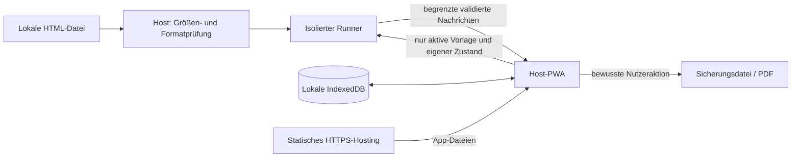

# Architektur: Ausgangshypothesen und Prüfaufträge

Dies ist ein Planungsstand, keine abgeschlossene technische Spezifikation und kein Sicherheitsnachweis.

## Vorläufige Komponenten

1. **Host-PWA:** später React/TypeScript mit Vite, Arbeitshefte, Importprüfung, Sicherungen und explizit ausgelöste Dateiweitergabe. Der Sicherheitsprototyp darf zunächst mit TypeScript und minimaler HTML-Oberfläche auskommen.
2. **Lokale Persistenz:** IndexedDB; Entscheidung zwischen direkter API und Dexie anhand Transaktionen, Migrationen, Bündelgröße und Wartung.
3. **Runner:** iframe mit opaque Origin, zunächst nur `allow-scripts`, kein `allow-same-origin`. Es erhält ausschließlich die aktive Vorlage und deren eigenen Zustand.
4. **Bridge:** versionierter, eng begrenzter Sitzungskanal. Keine frei wählbaren Datenbank-IDs, URLs oder Host-Befehle aus dem Arbeitsblatt.
5. **Export:** später gesonderter isolierter Renderkontext, aus dem nur begrenzte Exportdaten zurückkommen. Kein Kopieren des Arbeitsblatt-DOM in die Hauptanwendung.
6. **Hosting:** statische App-Auslieferung über HTTPS. Keine Schülerdatenbank, Konten, Analytics oder öffentliche Upload-API in der ersten Ausbaustufe.

## Vorläufige Daten- und Nachrichtenverträge

- `TemplateVersion`: unveränderliche Vorlage, eigene ID, Versionskennung, Inhalts-Hash und Metadaten; der Hash beweist keine Sicherheit.
- `WorksheetInstance`: eigene ID, Verweis auf exakt eine Vorlagenversion, Arbeitsheft-/Ordnerzuordnung und Status.
- `StateRevision`: Instanz-ID, Schema-Version, monotone Revision und begrenzter JSON-Zustand. Host ordnet Nachrichten der aktiven Instanz zu.
- `Notebook` / `Folder`: stabile IDs; zyklenfreie Hierarchie, definierte Lösch- und Verschiebesemantik.
- Sicherungsformat: versioniertes Manifest, Vorlagen, Struktur und Zustände; später atomare Wiederherstellung nach vollständiger Validierung.
- Bridge-Kandidaten: `READY`, `RESTORE_STATE`, `STATE_CHANGED`, `REQUEST_STATE`, `STATE_SNAPSHOT`; Export erhält einen später separat spezifizierten Vertrag.
- Jede Sitzung erhält eine neue Zuordnung und Sequenzkontrolle. Exakte Byte-, Frequenz- und Zeitlimits werden vor Implementierung festgelegt und mit Grenzwerttests belegt.
- Ein Sitzungstoken authentifiziert kein vertrauenswürdiges Arbeitsblatt: dessen Skript bleibt Angreifer innerhalb seines Frames. Privilegien werden im Host begrenzt.

## Technische Spannungen, die vor einer Zusage aufzulösen sind

| Thema | Problem | Erforderlicher Nachweis / Entscheidung |
|---|---|---|
| Beliebiges JavaScript und vollständiges Netzwerkverbot | iframe-Sandbox und `connect-src 'none'` allein blockieren nicht jede Ressource und insbesondere nicht automatisch die Selbstnavigation des Frames. | Navigation, CSP-Vererbung, Parent-`frame-src` und Request-Ausgänge in echten Browsern untersuchen. Bei Scheitern keine Freigabe beliebigen JS; einen strengeren Ausführungsansatz oder ein eingeschränktes Format entwerfen. |
| Inline-Skripte und CSP | Skriptfähige Fremddokumente benötigen andere Regeln als die Host-App. | Getrennte Policies; keine pauschale Lockerung der Host-CSP. Inline-Handler, eval, Module, Worker und dynamische Imports getrennt klassifizieren. |
| Opaque Origin und Kommunikation | `event.origin === 'null'` identifiziert keinen bestimmten Frame. | `event.source`, frischer Kanal, Schema, Größenlimit, Rate-Limit und Kanalverwerfung bei Dokumentwechsel. |
| Getrennte Origin und Offline | Ein anderer Pfad ist keine Origin-Grenze; Service Worker kontrollieren nicht beliebige fremde Origins. | srcdoc-/Blob-Runner und gegebenenfalls separate Origin hinsichtlich CSP, Start, Cache und Offline-Neustart vergleichen. |
| Universelle Zustandserkennung | DOM-Felder erfassen nicht automatisch Canvas, JS-Objekte, Drag-and-Drop oder Shadow DOM. | Unterstützte Basiseingaben explizit benennen; komplexe Zustände über versionierten Adapter. Inkompatibilität sichtbar anzeigen. |
| PDF und Isolation | Der Host darf nicht auf opaque DOM zugreifen; Rendering benötigt eigene Bibliotheken und Speicher. | Isoliertes seitenweises Rendering testen; keine zusätzliche Sandbox-Berechtigung nur für Druckkomfort. |
| Browser-Druck und PDF-Datei | Ein Druckdialog bietet nicht auf jeder Plattform denselben Dateiexport oder System-Share-Ablauf. | Druckweg und lokal erzeugte PDF getrennt abnehmen. Datei-Download als Fallback für fehlendes Web Share. |
| Ressourcenmissbrauch | iframe bedeutet keine garantierte CPU-/RAM-Quote und keine zuverlässige Prozessisolation. | Endlosschleifen und Speicherlast in isolierten Testprozessen; Wiederanlauf prüfen, verbleibende Grenze dokumentieren. |
| Lokale Dauerhaftigkeit | IndexedDB, persistenter Speicherantrag und Autosave garantieren keine dauerhafte Sicherung. | Quoten-/Abbruchtests, sichtbarer Speicherstatus, Backup und Wiederherstellung. |
| Gemeinsam genutzte Geräte | Kontofrei bedeutet keine Zugriffstrennung zwischen Schülern desselben Browserprofils. | Vor Pilotbetrieb explizites Gerätekonzept; lokale Namen/Profile nicht als Zugriffsschutz darstellen. |

Ein von untrusted HTML geliefertes PDF oder Bild bleibt ebenfalls untrusted. Dateitypbehauptung, Dateiname oder Größenangabe der Sandbox dürfen keine privilegierten Aktionen auslösen. Die PDF-Phase prüft auch, welche Integritätsgarantien ein Renderer im selben Skriptkontext wie Fremdcode überhaupt geben kann.

## Kompatibilitätsziel für den ersten Versuch

Einzelne, eigenständige HTML-Dateien mit eingebetteten Ressourcen und eindeutig identifizierten Standardfeldern. Keine Archive, externen Bibliotheken, relativen Netzressourcen, fremden Frames oder beliebigen Dateisystemzugriffe im ersten Prototyp. Eine manuell geprüfte Demo und synthetische Angriffsdateien bilden den ersten Korpus.

Das ist ein begrenzter Versuchsumfang, keine endgültige Einschränkung des Produkts. Allgemeines HTML und das optimierte Arbeitsblattformat erhalten später getrennte, versionierte Unterstützungstabellen. Eine Zusicherung für absichtlich bösartiges JavaScript setzt erfolgreiche Isolationsexperimente voraus.
